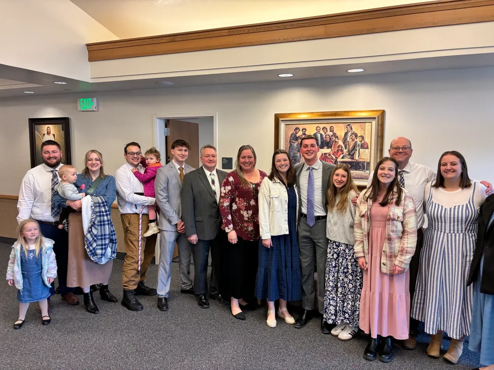

Morality means living by a standard of right and wrong and choosing to do right, even when no one is watching. I believe that standard comes from Heavenly Father. George Washington also got that connection. In his farewell, he said that “religion and morality are indispensable supports” of a free nation.  He also said “Let us with caution indulge the supposition that morality can be maintained without religion.” People need something more than the law to keep them good. John Adams said that if people let passions like greed and revenge run wild, they would go through the Constitution “as a whale goes through a net.” Laws can only do so much. A free government works when the people govern themselves first, and religion is what teaches them how.

One of my own moral choices came when I was asked to serve in the bishopric. At first, I was very hesitant. Between school and work, I already felt stretched thin, and I knew this calling would take a lot of time. The easy answer would have been to say I was too busy. Then I remembered counsel from my mission president. He said to never turn down a calling unless there is something the bishopric doesn’t know. Deep down I knew being busy wasn’t a good excuse. The more I thought about it, the more I felt Heavenly Father was giving me a chance to serve others and grow. So I said yes and it turned out to be an amazing calling that I really enjoy, and it has taken much less time than I expected. It taught me to serve the Lord with all my might and trust Him with the rest.

Today, I feel like marriage and family are under the most pressure. Religious freedom may become a bigger issue later too. Right now, people are still free to practice their religion of course, but there is less social support for actually living it. To stay steady, I do scripture study and going to the temple often. Those habits keep me close to Heavenly Father no matter what is going on around me. I want my home to be protected from outside influences, and I want my future kids to be strong enough that when their faith is tested, they don’t give in to social pressure. I know the adversary will keep attacking. But I trust that the Lord is leading His Church where it needs to go. Goerge Washington believed a nation stays good when its people do, and for me, that starts at my home.
