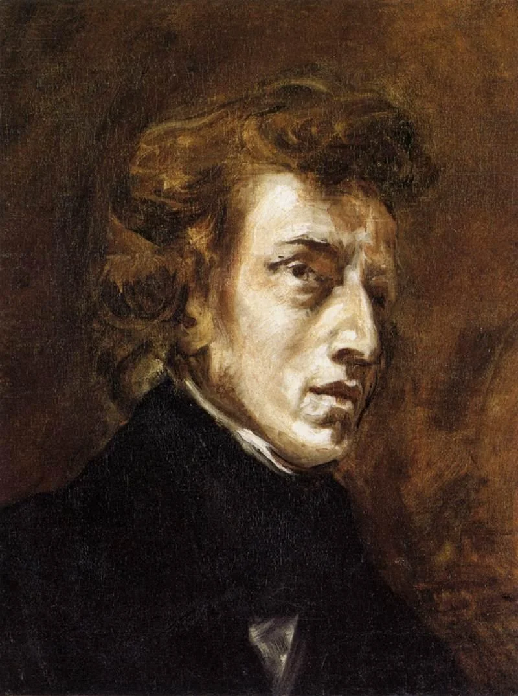

During the 1800s a lot of Romantic composers started using their music to show love for their home country, which is nationalism. A good example is Bedřich Smetana, who wrote a set of six symphonic poems called _Má vlast_, which means "My Homeland." The most famous one is _The Moldau_, and it follows the Vltava River from the mountains, through the Czech countryside, and all the way to Prague (Britannica). Smetana actually finished it in 1874 while he was completely deaf, which is pretty amazing. Frédéric Chopin is another example. He left Poland in 1830 at age 20 and never went back, but he kept writing mazurkas and polonaises, which are traditional Polish dances. Robert Schumann even called Chopin's works "cannons sunk beneath flowers" because of how much national pride was hidden in them (Elbphilharmonie). Before Chopin died in Paris, he asked for his heart to be taken back to Warsaw, and his sister made sure that happened ("Fryderyk Chopin").

For me, I don't have a homeland in the same way, but I do have a heritage I'm proud of. My family originally came from the Netherlands, and they came to America a long time ago, even before the pioneer days. On my dad's side I also have pioneer ancestors and early converts to the Church who gave up a lot for the gospel. My grandpa served in World War II, and he is someone I have always looked up to. We don't have many big family traditions, but one kind of random one is Zuppa Toscana, a copycat of the Olive Garden recipe that has been a favorite in my mom's family for a couple generations. The biggest thing that's been passed down though is our faith in the Church of Jesus Christ of Latter-day Saints. I also saw this kind of pride on my mission in Denver, Colorado, where people were proud of where they lived in more ways than one.

Smetana and Chopin used their music to keep their culture alive, especially while other countries were in control of their homelands. In a smaller way, I want to do the same thing for my family. My wife Marisa and I are planning to start having kids, and I want them to know where they come from. One way I plan on doing that is through family history and temple work, so our ancestors are not forgotten. I also want to tell my kids about my grandpa and what he did in World War II. Chopin kept writing Polish dances even when he was far from Poland, and I think that's kind of like keeping traditions going even when life gets busy. In our faith, the most important heritage is the gospel, and that's the main thing I want to pass on, just like my parents and grandparents did for me.

Works Cited

Britannica, The Editors of Encyclopaedia. "The Moldau." _Encyclopedia Britannica_, [www.britannica.com/topic/The-Moldau](http://www.britannica.com/topic/The-Moldau).

"Frédéric Chopin." _Elbphilharmonie Mediatheque_, [www.elbphilharmonie.de/en/mediatheque/frederic-chopin/169](http://www.elbphilharmonie.de/en/mediatheque/frederic-chopin/169).

"Fryderyk Chopin." _Great Composers_, Fryderyk Chopin Institute, greatcomposers.nifc.pl/en/chopin/composer.
